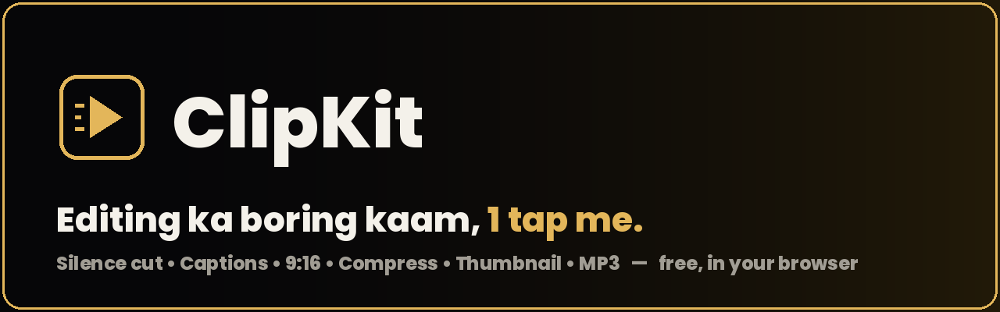
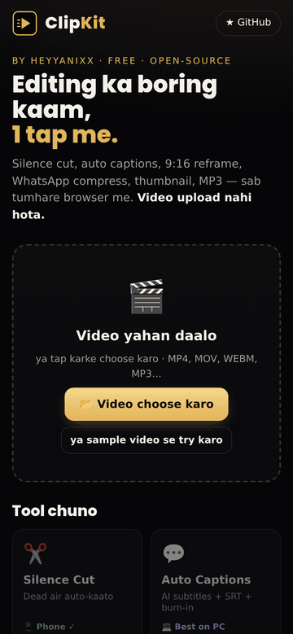
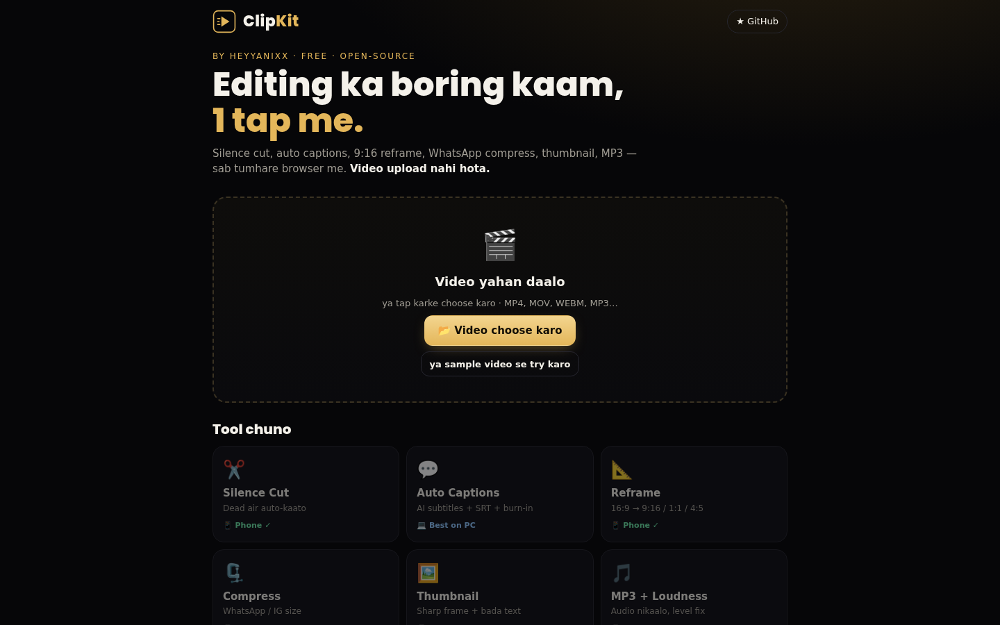

<p align="center">
  
</p>

<h1 align="center">ClipKit 🎬</h1>
<p align="center"><b>Free, in-browser video helper for editors & creators.</b><br>
Silence cut • Auto captions • 9:16 reframe • Compress • Thumbnail • MP3 + loudness<br>
<i>No upload. No signup. No paid API. Your video never leaves your device.</i></p>

<p align="center">
  <a href="https://heyyanixx-clipkit.sites.tab.bot/"></a>
  <a href="LICENSE"></a>
  
  
</p>

<p align="center">&nbsp;&nbsp;</p>

## Why?

Every editor wastes time on the same boring jobs: cutting dead air, typing captions, turning a 16:9 video into a 9:16 Short, squeezing a file under WhatsApp's limit, hunting for a sharp thumbnail frame. Desktop apps do all of this, but not everyone has a powerful PC or a paid subscription. **ClipKit does these jobs in a phone or laptop browser, for free.**

## Features

| Tool | What it does | Phone | PC |
|---|---|:-:|:-:|
| ✂️ **Silence Cut** | Finds quiet gaps (dead air) and makes a jump-cut version. Waveform preview, threshold / min-gap / padding sliders, list of cuts, `.txt` cut list | ✅ short clips | ✅ |
| 💬 **Auto Captions** | Whisper AI transcript → editable captions → **.SRT** download or **burn-in** styled captions (Shorts yellow, white box, gold…) placed inside the Shorts/Reels safe zone. Hindi (Devanagari) font included | ⚠️ works, slow | ✅ best |
| 📐 **Reframe** | 16:9 → **9:16 / 1:1 / 4:5 / 16:9**. *Crop* with a position slider, or *Blur fill* (whole video + blurred background). Live preview | ✅ (720p) | ✅ |
| 🗜️ **Compress** | Pick a target size (16 MB WhatsApp, 25 MB, 50 MB or custom) → ClipKit picks the resolution and bitrate and shows an estimate first | ✅ | ✅ |
| 🖼️ **Thumbnail** | Scans the video for the **sharpest** frames (Laplacian blur check), then adds big two-line text → **1280×720 PNG** | ✅ fast | ✅ |
| 🎵 **MP3 + Loudness** | Extract audio as MP3 / M4A / WAV, optionally normalised to **−14 LUFS** (YouTube/Instagram) or **−16 LUFS** (podcast). Shows the measured loudness of the result | ✅ fast | ✅ |

**Chain tools:** every result has *"Isi result pe aur tool lagao"* — e.g. Silence Cut → Captions → 9:16, without downloading in between.

## How to use

1. Open **https://heyyanixx-clipkit.sites.tab.bot/** (Chrome / Edge / Safari, phone or PC).
2. Drop a video (or tap *sample video*).
3. Pick a tool, adjust, press the gold button, download.

The first time, the browser downloads the video engine (~31 MB) and — for captions — the Whisper model (Tiny ~45 MB / Base ~95 MB). After that they are cached.

## Honest limits

- Browser video processing is **single-threaded** (it works without special server headers), so it is slower than desktop apps. Use the **720p** options on phones.
- Phones: keep clips short (1–3 min) and the screen on. Files over ~200 MB show a warning on phones; over ~2 GB is not supported in the browser.
- Captions: Whisper Tiny/Base are small models — **Hindi/Hinglish accuracy is rough**, always review the text before exporting. Caption timing is per phrase (split into 3–5 word chunks), not exact word-by-word.
- Loudness: if the audio has very sharp peaks, ClipKit will not clip them, so the result can land a little below −14 LUFS (it tells you the real number).
- Silence Cut re-encodes the video (frame-accurate cuts) and outputs a constant frame rate.

## Run locally / contribute

```bash
git clone https://github.com/heyyanixx/clipkit
cd clipkit
npm install
npm run dev      # http://127.0.0.1:5173
npm run build    # static site in ./site
```

Code map: `src/ff.ts` (ffmpeg.wasm wrapper, WORKERFS mount so big files are not copied into memory), `src/asr.worker.ts` (Whisper in a Web Worker), `src/tools/*.ts` (one file per tool), `src/style.css` (black & gold UI).

Ideas welcome — open an issue or a PR:
- [ ] Word-level caption timing + animated "karaoke" captions
- [ ] Trim / split tool
- [ ] Batch mode (many clips at once)
- [ ] Hindi UI toggle
- [ ] Multi-thread engine when the host sends cross-origin isolation headers

Please keep it: free, no uploads, no trackers, mobile-first.

## Credits

Built by **Anish — [HEYYANIXX](https://github.com/heyyanixx)** · BCA AI student & video editor from India.
[Instagram @heyyy.anixx_](https://www.instagram.com/heyyy.anixx_/) · [YouTube @smart_anish69](https://www.youtube.com/@smart_anish69) · kranish7900@gmail.com

Open-source pieces it stands on: [ffmpeg.wasm](https://github.com/ffmpegwasm/ffmpeg.wasm) (MIT; the FFmpeg core is LGPL/GPL), [transformers.js](https://github.com/huggingface/transformers.js) (Apache-2.0) with OpenAI Whisper weights (MIT), fonts Poppins and Noto Sans Devanagari (SIL Open Font License). ClipKit's own code is original and MIT-licensed.

## License

[MIT](LICENSE) © 2026 Anish (HEYYANIXX)
